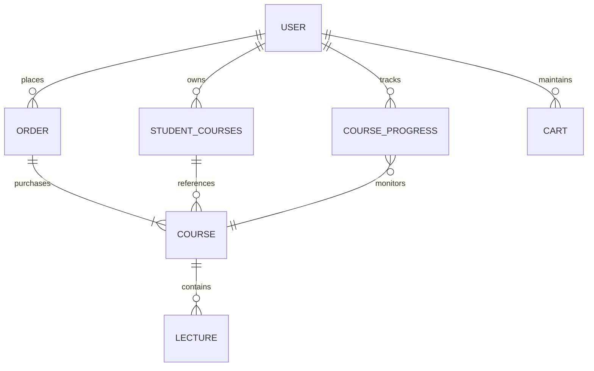

# 3. DATABASE AUDIT & SCHEMA ANALYSIS (DATABASE_AUDIT.md)

**Project:** Bhavin Academy LMS  
**Database Engine:** MongoDB  
**ODM:** Mongoose 8.x  
**Audit Date:** November 25, 2026  

---

## 1. Schema Review & Entity Definitions

### 1.1 Model: `User` (`server/models/User.js`)
- **Fields:** `userName`, `userFullName`, `userEmail`, `password`, `role`, `profileImage`, `userHeadline`, `userBio`, `status`, `googleId`, `microsoftId`, `timestamps`.
- **Primary Key:** `_id` (ObjectId)
- **Indexes:** None explicitly declared except default `_id`. `userEmail` and `userName` are checked manually in controller code but lack database-level unique indexes (`unique: true`).
- **Defects / Risks:**
  - Race conditions during concurrent registration can result in duplicate `userEmail` or `userName` documents.
  - No index on `googleId` or `microsoftId` causes table scans during OAuth lookups.

### 1.2 Model: `Course` (`server/models/Course.js`)
- **Fields:** `instructorId`, `instructorName`, `date`, `title`, `category`, `level`, `primaryLanguage`, `accessType`, `subtitle`, `description`, `image`, `welcomeMessage`, `pricing`, `objectives`, `students`, `curriculum`, `isPublished`.
- **Subdocument: `LectureSchema`:** `title`, `videoUrl`, `fileUrl`, `fileName`, `duration`, `public_id`, `freePreview`, `videoSource`, `notes`, `links`, `pdfs`, `section`.
- **Subdocument: `students`:** `studentId`, `studentName`, `studentEmail`, `paidAmount`, `purchasedDate`.
- **Defects / Risks:**
  - **Embedded `students` Array Scalability:** Storing every enrolled student inside the `Course` document's `students` array will breach MongoDB's 16MB document size limit for courses with high enrollment (e.g. 5,000+ students). This is a known MongoDB anti-pattern.
  - Lack of category index causes unbounded collection scans on `/courses` filter queries.

### 1.3 Model: `StudentCourses` (`server/models/StudentCourses.js`)
- **Fields:** `userId`, `courses: [{ courseId, title, instructorId, instructorName, dateOfPurchase, courseImage }]`.
- **Defects / Risks:**
  - Redundant denormalization: Enrollment data is stored in both `StudentCourses.courses` AND `Course.students` AND `Order.courses`.
  - No unique compound index on `{ userId: 1, "courses.courseId": 1 }`.
  - If a student is removed from a course, updates must be performed across 3 separate collections without a multi-document database transaction.

### 1.4 Model: `CourseProgress` (`server/models/CourseProgress.js`)
- **Fields:** `userId`, `courseId`, `completed`, `completionDate`, `lecturesProgress: [{ lectureId, viewed, dateViewed }]`.
- **Defects / Risks:**
  - Missing compound unique index on `{ userId: 1, courseId: 1 }`. If two requests hit `markLectureAsViewed` simultaneously, multiple progress records can be created for the same user and course.
  - Percentage completion calculation in `student-progress-controller.js` currently calculates progress based on `progress.lecturesProgress.length` instead of `course.curriculum.length`, which can artificially inflate completion to 100% when only 1 of 10 lectures has been recorded!

### 1.5 Model: `Order` (`server/models/Order.js`)
- **Fields:** `userId`, `userName`, `userEmail`, `orderStatus`, `paymentMethod`, `paymentStatus`, `orderDate`, `razorpayOrderId`, `razorpayPaymentId`, `razorpaySignature`, `courses`.
- **Defects / Risks:**
  - `coursePricing` is stored as a `String` rather than `Number`. This complicates aggregation queries and requires `parseFloat()` in controller code.
  - `razorpayOrderId` lacks a unique sparse index, which could allow duplicate order records during network retries.

### 1.6 Model: `Cart` (`server/models/Cart.js`)
- **Fields:** `userId`, `items: [{ courseId, title, instructorName, image, pricing }]`.
- **Defects / Risks:**
  - `userId` is not indexed, leading to collection scans on every page load for logged-in users.
  - Cart items store a snapshot of `pricing`. If an admin updates course pricing, the student's cart retains the stale price unless validated at checkout.

---

## 2. Integrity & Relational Map

---

## 3. Recommended Database Schema Improvements
1. Add compound index: `CourseProgressSchema.index({ userId: 1, courseId: 1 }, { unique: true })`.
2. Add unique sparse index on `UserSchema.index({ userEmail: 1 }, { unique: true })`.
3. Add unique sparse index on `OrderSchema.index({ razorpayOrderId: 1 })`.
4. Fix progress percentage calculation: always divide `viewedCount` by `course.curriculum.length`.
