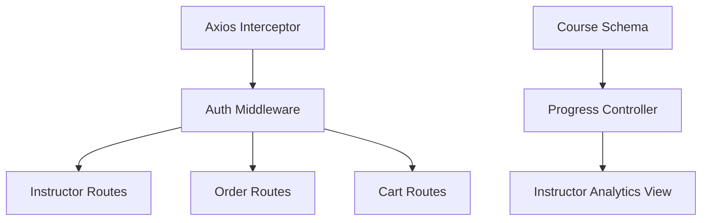

# 9. RISK & DEPENDENCY ANALYSIS (RISK_AND_DEPENDENCY_ANALYSIS.md)

**Project:** Bhavin Academy LMS  
**Date:** November 25, 2026  

---

## 1. Technical Risks & Mitigation Strategies

| Risk ID | Risk Description | Likelihood | Impact | Severity | Mitigation Strategy |
| :--- | :--- | :--- | :--- | :--- | :--- |
| **RISK-01** | Adding `authenticateMiddleware` to `/instructor/*` blocks existing client calls if token header is omitted. | Medium | High | High | Verify `client/src/api/axiosInstance.js` automatically injects `sessionStorage.getItem("token")` via interceptor. Ensure client redirects cleanly to `/auth` on 401. |
| **RISK-02** | Modifying password in MongoDB without current password verification could allow account takeover if session token is stolen. | Low | High | Medium | Enforce verification of existing `password` with `bcrypt.compare` before hashing and saving new password. |
| **RISK-03** | Missing environment variables (`JWT_SECRET`, `RAZORPAY_KEY_ID`, `MONGO_URI`) causing server crash on production cold starts. | Low | Critical | High | Add explicit startup configuration checks in `server/server.js` with clear diagnostic logs. |
| **RISK-04** | Index creation on existing collections with duplicate data causing migration errors. | Low | Medium | Low | Use non-blocking or background index creation in Mongoose schemas. |

---

## 2. Dependency Matrix

