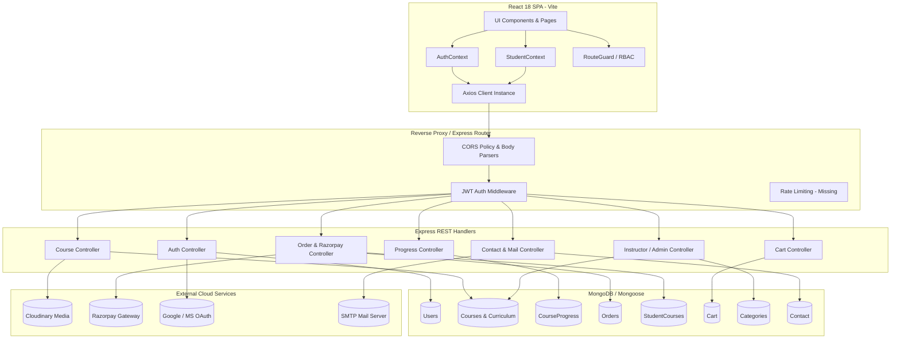

# 1. SYSTEM ARCHITECTURE & REVERSE-ENGINEERING (SYSTEM_ARCHITECTURE.md)

**Project:** Bhavin Academy LMS (BhavinAcademy)  
**Target Standard:** Enterprise Udemy-grade Learning Experience & Robustness  
**Date:** November 25, 2026  
**Auditor:** Principal Enterprise Software Architect & Security Auditor  

---

## 1. High-Level Architectural Overview

The application is structured as a decoupled full-stack JavaScript/Node.js web application:
- **Client Tier:** Single Page Application (SPA) built with React 18, Vite, React Router DOM v6, Tailwind CSS, Radix UI primitives (`@radix-ui/*`), Lucide React icons, and Framer Motion.
- **Server Tier:** RESTful API server powered by Node.js and Express 4.x, utilizing JWT bearer token authentication, Multer for multipart media processing, and Cloudinary SDK for cloud-hosted assets.
- **Data Tier:** Document-based persistence running on MongoDB with Mongoose ODM (Object Data Modeling).
- **Payment & Gateway Tier:** Native integration with Razorpay Orders & Verification API (`razorpay`), legacy PayPal REST SDK bindings (`paypal-rest-sdk`), and internal zero-cost enrollment (`createFreeOrder`).

---

## 2. Frontend-to-Backend Communication Matrix

| Client Service (`client/src/services/index.js`) | HTTP Verb | Target Endpoint | Associated Controller / Handler | Auth Header Required | Description |
| :--- | :--- | :--- | :--- | :--- | :--- |
| `registerService` | POST | `/auth/register` | `authController.registerUser` | No | Student/User registration with bcrypt hashing |
| `loginService` | POST | `/auth/login` | `authController.loginUser` | No | Issue JWT token upon credential validation |
| `checkAuthService` | GET | `/auth/check-auth` | `authenticateMiddleware` | Yes | Validates session token on page reload |
| `googleLoginService` | POST | `/auth/google-login` | `authController.googleLogin` | No | Google OAuth token verification & profile sync |
| `microsoftLoginService` | POST | `/auth/microsoft-login` | `authController.microsoftLogin` | No | Microsoft Graph token & profile sync |
| `fetchStudentViewCourseListService` | GET | `/student/course/get` | `courseController.getAllStudentViewCourses` | No | Course discovery with category/level filter params |
| `fetchStudentViewCourseDetailsService`| GET | `/student/course/get/details/:id`| `courseController.getStudentViewCourseDetails`| No | Public course hero, objectives, curriculum & pricing |
| `fetchStudentBoughtCoursesService` | GET | `/student/courses-bought/get/:id` | `studentCoursesController.getCoursesByStudentId` | No | Enrolled courses displayed on "My Courses" |
| `getCurrentCourseProgressService` | GET | `/student/course-progress/get/:userId/:courseId` | `courseProgressController.getCurrentCourseProgress` | No | Fetches lecture completion matrix & active lecture |
| `markLectureAsViewedService` | POST | `/student/course-progress/mark-lecture-viewed` | `courseProgressController.markCurrentLectureAsViewed` | No | Records lecture completion & auto-completes course |
| `resetCourseProgressService` | POST | `/student/course-progress/reset-progress` | `courseProgressController.resetCurrentCourseProgress` | No | Clears viewed lectures array |
| `createPaymentService` | POST | `/student/order/create` | `orderController.createOrder` | No | Initializes Razorpay order and returns signature token |
| `captureAndFinalizePaymentService`| POST | `/student/order/capture` | `orderController.capturePaymentAndFinalizeOrder` | No | Validates HMAC SHA-256 signature and grants course access |
| `createFreeOrderService` | POST | `/student/order/create-free` | `orderController.createFreeOrder` | No | Enrolls student directly for zero-price courses |
| `fetchInstructorCourseListService` | GET | `/instructor/course/get` | `instructorCourseController.getCourses` | No | Admin course table with publish status |
| `addNewCourseService` | POST | `/instructor/course/add` | `instructorCourseController.addNewCourse` | No | Creates new course document with curriculum |
| `updateCourseByIdService` | PUT | `/instructor/course/update/:id` | `instructorCourseController.updateCourse` | No | Updates course metadata & lectures |
| `deleteCourseByIdService` | DELETE| `/instructor/course/delete/:id` | `instructorCourseController.deleteCourse` | No | Deletes course document |
| `fetchInstructorStudentProgressService`| GET | `/instructor/student-progress/get` | `studentProgressController.getStudentProgress` | No | Aggregated analytics & progress for all enrolled users |
| `submitContactService` | POST | `/contact/submit` | `contactController.submitContactForm` | No | Stores inquiry and dispatches support email |

---

## 3. End-to-End User Journeys

### 3.1 Student Learning & Course Progress Journey
1. **Discovery:** Student visits `/courses`, searches via query or category pills, and selects a course card.
2. **Evaluation:** Navigates to `/course/details/:id`. Views curriculum breakdown, instructor bio, and previews free lectures via the dedicated video or rich-text notes modal.
3. **Cart & Checkout:** Student clicks "Enroll Now" or "Add to Cart". If logged in, proceeds to `/checkout`.
4. **Order Execution:** For paid courses, Razorpay modal opens. Upon signature confirmation, backend creates `StudentCourses` record, adds student details to `Course.students`, and invalidates cart.
5. **Classroom Player (`/course-progress/:id`):** 
   - Verifies enrollment status (`isPurchased`).
   - Displays video player or rich-text reading canvas.
   - Right-hand side chapter pane displays all sections, lectures, completion checkmarks, and duration badges.
   - Marking lecture complete updates `CourseProgress`. When 100% is reached, confetti and claimable certificate modal trigger.

### 3.2 Admin / Instructor Management Journey
1. **Access:** User logs in with `role: "admin"` or `role: "instructor"`. RouteGuard allows navigation to `/instructor`.
2. **Dashboard Overview:** Displays revenue stats, student count, course count, and analytics.
3. **Course Builder (`/instructor/course/create` or `/edit/:id`):**
   - Step 1: Course Title, Subtitle, Full Description, Category, Level, Primary Language.
   - Step 2: Visual banner picker (Image upload via Cloudinary or custom gradient + icon).
   - Step 3: Curriculum Builder: Multi-section accordion with reorderable lessons, type toggles (Video, Quiz, Document), Video URL, Downloadable File URL, Lesson Notes, Duration, and Free Preview checkbox.
   - Step 4: Pricing (Free vs Paid).
4. **Student Analytics & Export:** Live table displaying enrolled students, completion percentages, order dates, and structured Excel export (`client/src/utils/export.js`).
